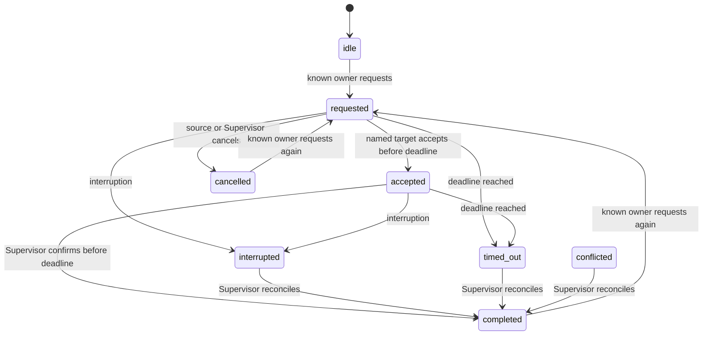

# Alarm and responsibility state machine

This model defines a fictional coordination protocol. It is not PX4's control protocol. Mode describes vehicle behavior; owner records who is responsible in the scenario. Both can be unknown or stale independently.

Any phase can enter conflicted on a scripted report conflict. A timed-out request may be retried only with a known owner. Diagram label `timed_out` corresponds to JSON value `timed-out`.

| Phase | Ownership | Next actor | Exit condition |
| --- | --- | --- | --- |
| idle | Initial actor if evidenced; otherwise unresolved | Current actor with the same freshness state | Valid request |
| requested | Source retains ownership and its original timestamp | Named target | Accept, cancel, interrupt or deadline |
| accepted | Unresolved until confirmation | Supervisor | Confirm, interrupt or deadline |
| completed | Confirmed or reconciled actor | Confirmed actor | New request or conflicting evidence |
| cancelled | Source retains ownership and original timestamp | Source with the same freshness state | New request |
| timed-out | Source if never accepted; unresolved if accepted | Supervisor | Reconcile, or retry with known owner |
| interrupted | Unresolved | Supervisor | Reconcile |
| conflicted | Unresolved | Supervisor | Reconcile |

Acknowledgment is an independent per-alarm set of receipts. It neither clears an alarm nor accepts a handover. Two acknowledgment actors may coexist without proving either is the owner. A clear event removes that active alarm and its active receipt display; the event history remains available.

Every event at a checkpoint is included, in script array order. A deadline is processed before events at that same second, so an acceptance arriving exactly at the deadline is too late. Unknown ownership begins at acceptance, interruption, conflicting reports, or accepted timeout. A known owner is restored only by a valid Supervisor confirmation or reconciliation. Invalid transitions remain visible as rejected history entries.

Freshness uses `age > ttl`, with equality still known. Defaults are 5 seconds for telemetry, 10 for mode and 30 for ownership. Principal-issue assertions do not expire in these scripts. Explicit null observations are unknown. Historical last-reliable telemetry retains its observation time after newer data becomes stale or absent. These illustrative thresholds are parameters, not operational guidance.

Timestamps record evidence or transition times. `nextActor` uses the handover transition time in requested, accepted, interrupted, conflicted and timed-out states; otherwise it inherits the owner's evidence timestamp and state. Target timestamps change on request and on explicit clearing by confirm, cancel or reconcile. Clearing a receipted alarm updates the receipt-summary timestamp. Unknown values caused by events retain the event time; never-observed values have null timestamps.

Completion requires a known owner, zero active alarms and an idle, completed or cancelled handover. Incident scripts additionally restore the principal issue to No active issue. An interrupted or timed-out incident is not complete merely because the replay has ended. Replay position and incident completion are separate concepts.
