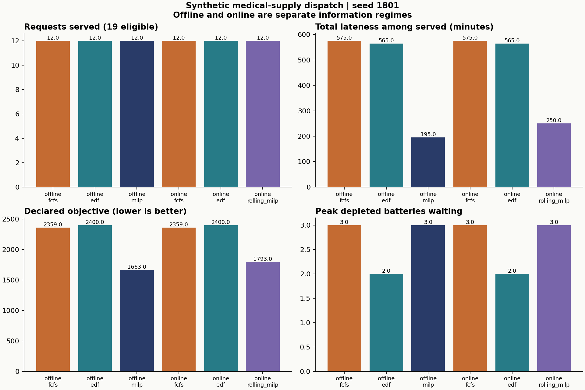
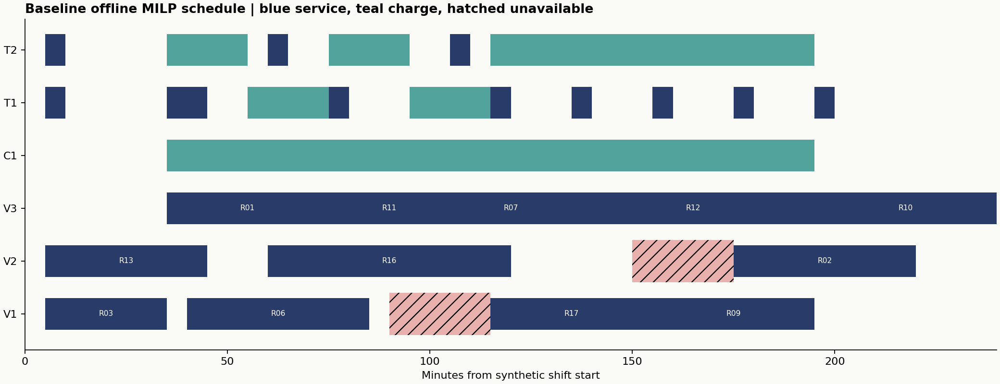
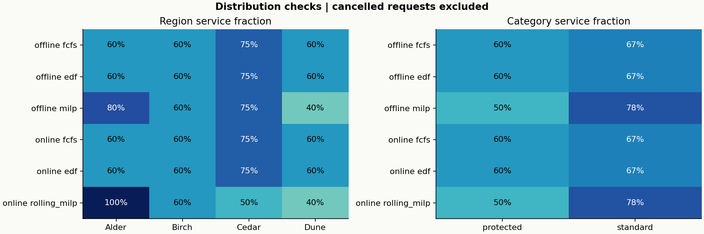
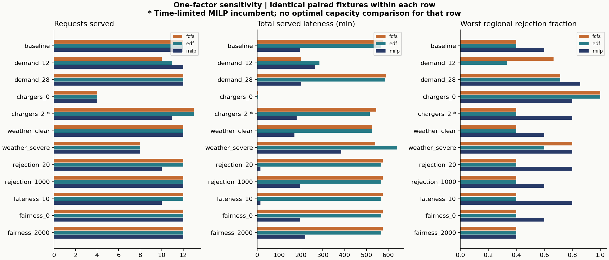

# Synthetic dispatch experiment report

Run date: 2026-10-17T21:56:48.968289-04:00. Seed 1801. All inputs and annotations were AI-generated; there are no real delivery observations.

## Scope and information

The baseline has 20 requests, including one pre-cancelled request, three vehicles, four initially full batteries, one charger and two technicians. The shift is 48 five-minute slots (240 minutes). Loading, handoff and turnaround each take one slot; a charge takes four slots and occupies a technician throughout. Every trip returns to the abstract depot. No geography, flight dynamics, real weather or clinical decisions are modeled.

The offline experiment supplies all demand at time zero, subject to release constraints. FCFS and EDF deliberately use their declared myopic queue rules; MILP may plan for future releases. The online experiment reveals requests only at release. All online policies know the same availability calendar. Rolling MILP commits current starts and preserves executed history, with a new solve each slot. Offline results and online results are separate comparisons.

The objective minimizes 200 times priority-weighted rejections, plus priority-weighted late minutes, plus one per charge, plus 100 times the worst regional rejection fraction. Its weights allow service counts to trade against lateness and fairness. All coefficients and priorities are administrative assumptions. Deadlines concern handoff and are soft. Return and turnaround must finish within the horizon.

## Baseline results

| Information | Policy | Served | Rejected | On time | Late minutes | Objective | Lower bound | Gap |
|---|---|---:|---:|---:|---:|---:|---:|---:|
| offline | fcfs | 12 | 7 | 3 | 575 | 2,359.00 | not claimed | not claimed |
| offline | edf | 12 | 7 | 3 | 565 | 2,400.00 | not claimed | not claimed |
| offline | milp | 12 | 7 | 9 | 195 | 1,663.00 | 1,663.00 | 0.00% |
| online | fcfs | 12 | 7 | 3 | 575 | 2,359.00 | not claimed | not claimed |
| online | edf | 12 | 7 | 3 | 565 | 2,400.00 | not claimed | not claimed |
| online | rolling_milp | 12 | 7 | 5 | 250 | 1,793.00 | not claimed | not claimed |

Late minutes are summed only over served requests. Rejections and on-time counts must be read beside that sum. Priorities also affect objective cost, so a smaller unweighted lateness total need not yield a smaller objective. Cancelled requests are excluded from denominators.

## Charging and resource use

| Information / policy | Charges | Completed queue wait, min | Peak queue | Returns not recharged | Censored dirty time, min | Vehicle utilization | Charger utilization | Technician utilization |
|---|---:|---:|---:|---:|---:|---:|---:|---:|
| offline / fcfs | 9 | 110 | 3 | 3 | 45 | 78.4% | 75.0% | 50.0% |
| offline / edf | 10 | 145 | 2 | 2 | 10 | 78.4% | 83.3% | 54.2% |
| offline / milp | 8 | 85 | 3 | 4 | 110 | 75.4% | 66.7% | 45.8% |
| online / fcfs | 9 | 110 | 3 | 3 | 45 | 78.4% | 75.0% | 50.0% |
| online / edf | 10 | 145 | 2 | 2 | 10 | 78.4% | 83.3% | 54.2% |
| online / rolling_milp | 8 | 75 | 3 | 4 | 110 | 76.9% | 66.7% | 45.8% |

Vehicle utilization divides busy time by available vehicle time, excluding calendar outages. Charger and technician utilization divide busy time by capacity times the full horizon. Queue wait is the time a depleted battery waits before charging; returns never recharged are reported separately as right-censored time. Terminal recharge is optional. The heuristics recharge proactively even without pending work, whereas MILP can avoid unnecessary terminal charges.

## Distribution and sensitivity

Dune service fractions for FCFS, EDF and offline MILP are 60%, 60% and 40%. Protected-category service fractions are 60%, 60% and 50%. These labels are fictional administrative categories. The base fairness weight permits tradeoffs; the objective contains no minimum regional or category service guarantee. Complete per-group counts, mean and maximum lateness are in distributions.csv.

| Case | FCFS objective | EDF objective | MILP incumbent | MILP lower bound | MILP gap | Served by MILP |
|---|---:|---:|---:|---:|---:|---:|
| baseline | 2,359.00 | 2,400.00 | 1,663.00 | 1,663.00 | 0.00% | 12 |
| demand_12 | 685.67 | 537.33 | 278.00 | 278.00 | 0.00% | 12 |
| demand_28 | 4,651.43 | 4,691.43 | 3,338.71 | 3,338.71 | 0.00% | 12 |
| chargers_0 | 3,905.00 | 3,905.00 | 3,080.00 | 3,080.00 | 0.00% | 4 |
| chargers_2 | 2,012.00 | 2,062.00 | 2,085.00 | 1,325.16 | 36.44% | 11 |
| weather_clear | 2,280.00 | 2,340.00 | 1,643.00 | 1,643.00 | 0.00% | 12 |
| weather_severe | 3,445.00 | 3,705.00 | 3,009.00 | 3,009.00 | 0.00% | 8 |
| rejection_20 | 1,099.00 | 1,140.00 | 281.00 | 281.00 | 0.00% | 10 |
| rejection_1000 | 7,959.00 | 8,000.00 | 7,263.00 | 7,263.00 | 0.00% | 12 |
| lateness_10 | 10,549.00 | 10,950.00 | 2,036.00 | 2,036.00 | 0.00% | 10 |
| fairness_0 | 2,319.00 | 2,360.00 | 1,603.00 | 1,603.00 | 0.00% | 12 |
| fairness_2000 | 3,119.00 | 3,160.00 | 2,453.00 | 2,453.00 | 0.00% | 12 |

Each row uses an identical demand and disruption fixture for every policy. Demand counts 12 and 28 use prefixes/extensions of the same seeded stream. Charging capacity, availability calendars and weights each change one factor. Objective values under different weight vectors are not directly comparable.

- With 12 requests, the lower-cost heuristic is edf; at baseline demand it is fcfs. Queue policy preference depends on demand.
- With no charger, at most four services can use the four initially full batteries. This is an inventory limit. The table retains the result for each policy.
- Severe known unavailability selects 8 MILP services, compared with 12 at baseline. Removing baseline outages gives 12 services and objective 1,643.00, compared with baseline objective 1,663.00.
- At rejection cost 20, the selected MILP schedule serves 10 with 15 late minutes. At lateness cost 10, it serves 10 with 15 late minutes. Baseline values are 12 and 195. The objective allows rejections to trade against delay.
- Raising fairness cost from 100 to 2,000 gives 12 services and a worst regional rejection fraction of 40%, compared with 60% at baseline. Unweighted lateness is 220 minutes versus 195. These outcomes reflect the supplied administrative weights.

**Unresolved optimization bound:** chargers_2 hit its 3-second limit. The MILP incumbent is 2,085.00, lower bound 1,325.16, gap 36.44%. The best exported policy for that row is fcfs at 2,012.00. These incumbent values do not establish a harmful effect of additional capacity. All candidates, including the weaker incumbent, are retained.

A separately checked capacity-transfer certificate reuses the baseline one-charger schedule with two chargers. Its objective 1,663.00 is another feasible upper bound. Combined with the two-charger solve's lower bound 1,325.16, its relative gap is 20.32%. This additional witness is exported as chargers_2_transfer__offline__capacity_transfer.json; no new solver optimum is claimed.

## Verification and computational limits

The package contains 74 independently feasible schedules: 39 policy comparisons, two witnesses for each of 17 tiny cases, and one capacity-transfer certificate. The runner calls the standard-library checker on every schedule before writing it. The separate audit reopens the artifacts and recomputes feasibility and metrics.

The hand case has a charging conflict at minute 2. Its all-served schedule requires two recharges and has objective 2. Any rejected request costs at least 200, so 2 is also an analytical lower bound attained by that schedule. The exhaustive reference confirms 2 with 573 memoized states and 1,270 transitions. Its symmetry reduction exchanges only currently idle resources with identical future restrictions; it explores idling and rejection as well as service and charging.

All 17 exported tiny instances agree between exact rational state enumeration and the MILP objective and bound. They include zero requests, no vehicles, charging and staff bottlenecks, cancellation, simultaneous deadlines and after-horizon demand. The reference guards its bounded input domain explicitly.

Execution used Python 3.12.14, SciPy 1.17.1, HiGHS 1.12.0 and Matplotlib 3.10.8. The experiment completed in 28.83 seconds. Offline solve limits were 3 seconds, and online limits were 0.5 seconds per decision. See run_metadata.json, experiment.log and the source/reproduction documents for exact versions and commands.

HiGHS optimality and bounds are numerical solver results for the finite integer-slot formulation. They are distinct from the hand-derived argument and exact rational tiny enumeration. A rolling subproblem bound applies only to the requests visible at that decision. No global online optimum, competitive ratio or optimality gap is claimed. Solve records preserve every online status and local bound.

The rejection option makes the optimization model feasible even when full service is impossible. The no-vehicle tiny case cannot serve a request because each service requires a vehicle. The after-horizon case cannot satisfy release plus positive service duration before horizon. Such requests remain in the exports. No unsatisfiable-core computation is claimed.

## Limits and next step

The results cover one controlled synthetic benchmark stream with one-factor sweeps. They do not estimate real service performance. Online sensitivity beyond the baseline and unexpected weather are not evaluated. The five-minute grid, homogeneous full/depleted batteries, supervised charging, fixed mission durations and pre-cancellation-at-arrival rule are material assumptions. No energy physics, handling rules, storage constraints, patient priorities or real aviation requirements are validated. All annotations and code review came from AI assistants; methodologically independent checks are the separately implemented checker, exhaustive algorithm and hand argument.

All required bounded milestone gates are met. Larger-instance optimality remains unresolved where a time limit is reported; this is permitted by the bounded-solution criterion. The next concrete numerical step is a longer solve of the two-charger case while retaining its current incumbent and lower bound. Any operational use would first require separately established aviation, supply-handling and clinical requirements.
