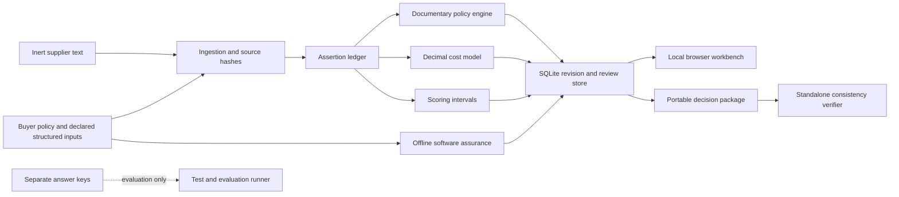

# Architecture

CEDAR runs as one loopback FastAPI process and a SQLite database. The browser is a static JavaScript client of the same server. The initial dataset is imported from a dedicated corpus directory; future changes are stored in the database. Analysis never reads the separate evaluation annotations.

| Boundary | Implementation | Contract |
|---|---|---|
| Source to assertion | `cedar/ingest.py` | Literal passages, SHA-256, line ranges, version, normalization and dates retained |
| Assertion to assessment | `cedar/engine.py` | Requirement applicability and evidence type are checked before support can be granted |
| Quotation to cost | `cedar/costs.py` | CAD Decimal arithmetic; unknown values create open exposures |
| Evidence to preference | `cedar/scoring.py` | Per-criterion min-max formula, explicit weights and score bounds |
| Inventory to finding | `cedar/assurance.py` | Offline official schema validation, bounded exact synthetic identifiers, exposure provenance |
| State to decision | `cedar/store.py` | Write transaction, expected revision, immutable record digest, separate review/approval events |
| Browser to authority | `cedar/app.py` | Opaque session, server role checks, CSRF, origin/host checks and bounded text upload |
| Decision to artifact | `cedar/export.py` | Exact record, escaped report, safe CSV, inert source filenames and self-contained verifier |

The store uses a single workspace row and a snapshot table because the dataset is deliberately small. Each snapshot copies its analysis inputs and evaluation. This trades storage for simple inspection and reproducibility. It is not an enterprise document repository or a multi-tenant service.

Every input mutation increments a revision inside `BEGIN IMMEDIATE`. The expected revision is checked under that lock. Approval checks the current revision, record digest, current input identity and technical review before writing an approval event. A concurrent amendment either follows the approval and makes it stale, or happens first and causes the attempted approval to fail. Every old snapshot remains exportable with its recorded inputs and current stale label.

Invalidation is conservative: any evidence, assumption, policy or assertion-review change stales every prior snapshot. The change log separately lists the assessments, costs and score contributions that actually changed. Selective reapproval of unaffected decisions is a possible future optimization, not a demonstrated feature.

The generative-model boundary is intentionally narrow. `cedar/adapters.py` declares proposal-only inputs and outputs; it contains no model client, credentials or permission to review or approve. The demonstrated application runs without a model and does not call the adapter.
