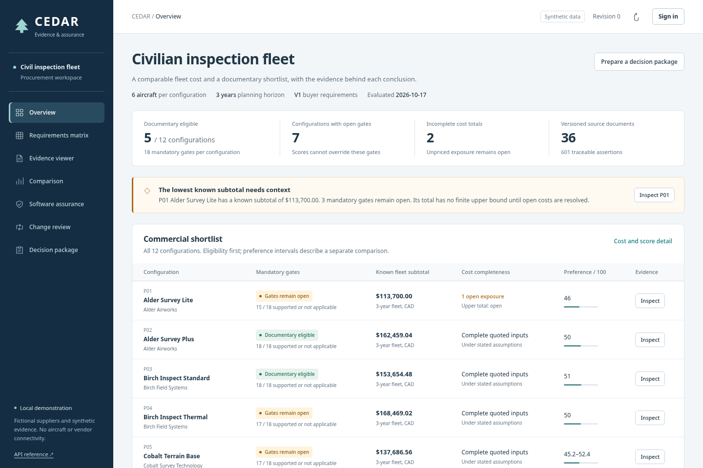
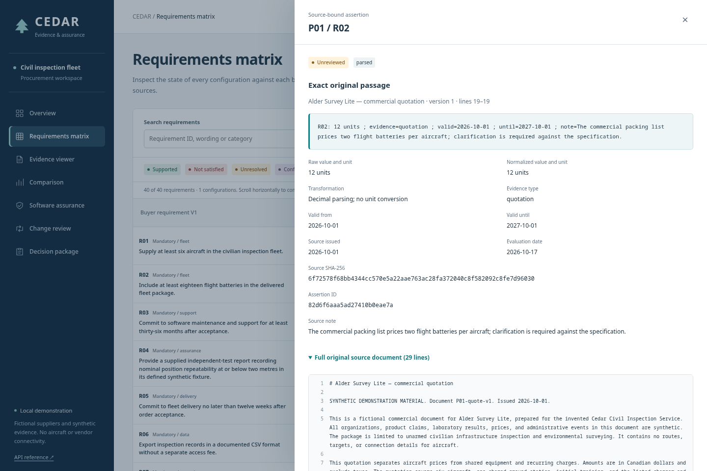
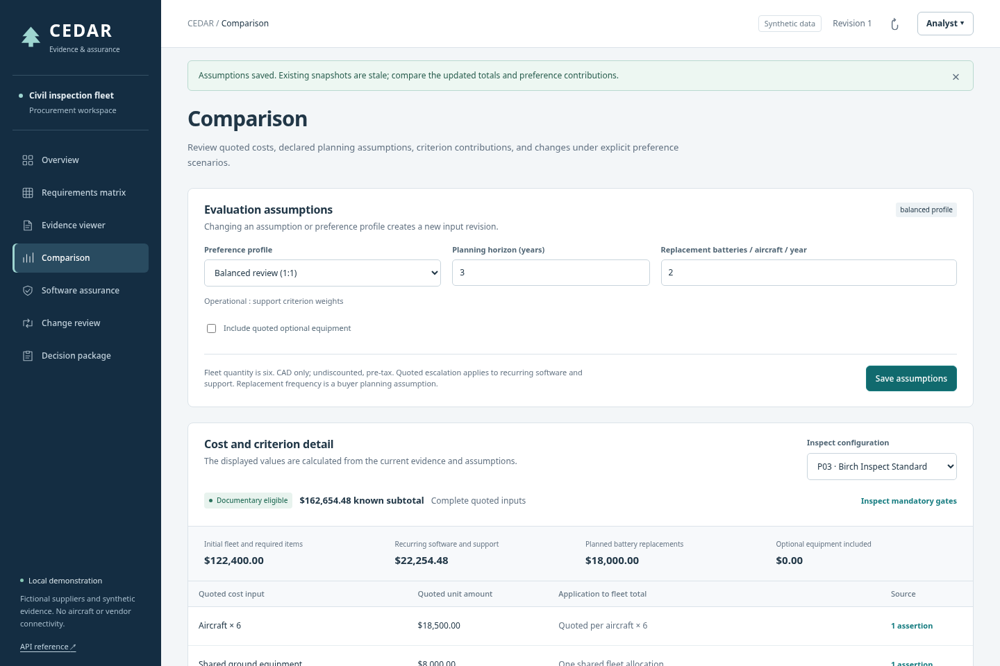
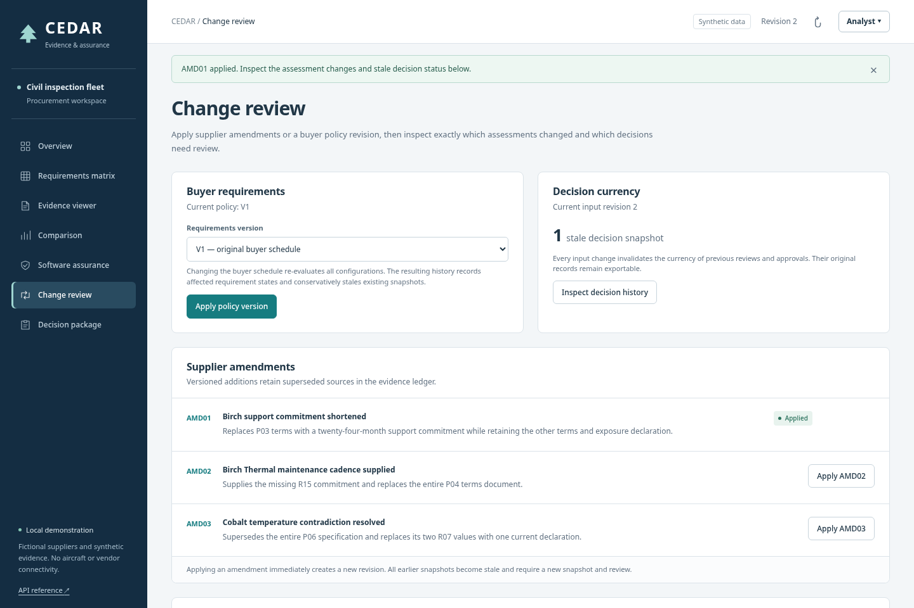
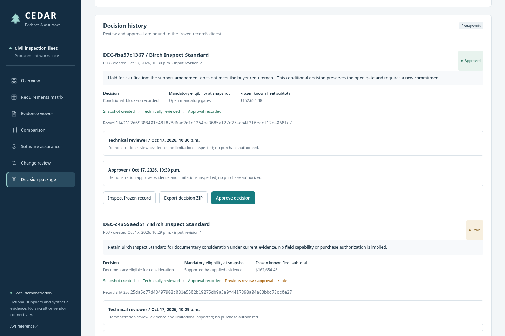

# CEDAR: preserving the evidence behind a procurement comparison

**Technical portfolio case study · Local synthetic demonstration**

CEDAR turns a purchasing comparison into an inspectable record of requirements, source passages, assumptions and review decisions. Its main demonstration starts with an apparently inexpensive offer that cannot pass the buyer's mandatory gates. It then follows a different offer through review, approval and a supplier amendment that invalidates the earlier conclusion.

The implemented system runs locally with Python, FastAPI, SQLite and a browser client. All suppliers, products, prices, test passages and advisories are fictional. It has no aircraft connection, purchasing authority or live model integration. Noah Weinberger supplied the project direction and background in AI red teaming, policy analysis and data provenance. The implementation, fixtures and portfolio were developed with AI assistance; manual authorship, customer validation and independent audit are not claimed.

## The commercial question

The fictional buyer needs six unarmed UAVs, shared ground equipment, software, training and multiyear support for civilian inspection. Comparing headline prices would hide material differences. P01's lowest known subtotal excludes a required component. Other offers contain contradictory specifications, expired commitments or declarations where the buyer requires a different evidence type.

A procurement manager needs a shortlist with its open commercial questions. An engineering reviewer needs to inspect whether the supplied evidence actually satisfies the stated documentary rule. A program manager needs to understand which amendment or planning assumption could change the conclusion. CEDAR implements that shared record. Reduced search time and easier collaboration remain proposed benefits to measure in a pilot.



*Figure 1. Actual browser capture at the initial input revision. Documentary eligibility and cost completeness are displayed separately.*

The project first completed a vertical slice with three packages, eight requirements, nine base documents and one amendment. The [Milestone A replay](../artifacts/milestone-a.json) preserves that checkpoint. The full corpus then expanded to six suppliers, twelve configurations, forty requirements, thirty-six base documents in three text layouts, three amendments and two buyer-policy versions. Twelve software inventories accompany the full corpus. The [annotation notes](../evaluation/annotation-notes.md) explain how the fixture stories and expected results were prepared.

## Why an assertion is more than a normalized value

A requirement records its identifier, exact wording, version, mandatory/scored/informational mode, applicability, accepted evidence types, units, comparator, dates and source. An assertion preserves the original statement alongside its normalized interpretation. Its identity incorporates the document identifier, source-content hash and starting line.

For example, P03's three-year support statement normalizes to 36 months. The ledger keeps the original `3 years`, the declared multiplication by 12, the accepted evidence type and the precise source version. A later document cannot replace that passage merely by using the same commercial title. Superseded sources remain available to the ledger and old snapshots.

The parser in [ingest.py](../cedar/ingest.py) recognizes explicit `Rxx`, cost and assurance response labels in table, label and block layouts. It implements three declared conversions: hours to minutes, years to months and kilograms to grams. It does not infer a requirement match from ordinary prose. An unrecognized response can therefore produce no assertion; the requirement stays unresolved. Original UTF-8 source bytes are preserved when reading the corpus, including line-ending differences relevant to hashes.



*Figure 2. The battery quotation can be inspected from its assessment. The displayed hash identifies the recorded source content; it does not establish that the quotation is truthful.*

The evidence model preserves four separate propositions: a supplier asserted a value; the supplied document meets the buyer's evidence rule; an independent test established a capability; and the product will perform that way in use. Only the first two are exercised here. An `independent_test` entry is a synthetic documentary category. No physical test occurred.

## Documentary gates before preferences

The [assessment engine](../cedar/engine.py) applies rules in a deliberate order. It first checks applicability and the policy's effective dates. It then identifies current, non-superseded, non-rejected evidence, detects conflicting values and unresolved interpretation, checks accepted evidence types and units, and finally applies the comparator. Invalid validity dates retain uncertainty even if another source appears usable. Repeating an equal claim does not create independent confirmation.

| State | Meaning for the buyer |
|---|---|
| Supported | Current supplied evidence of an accepted type meets the declared comparator. |
| Not satisfied | Interpretable current evidence fails that comparator. |
| Unresolved | Required support is absent, rejected, ambiguous, malformed or of an insufficient type. |
| Conflicting | Current interpretable observations disagree on value or normalized unit. |
| Stale | The policy is outside its effective period, or matching usable evidence is no longer current. |
| Not applicable | An explicit applicability rule excludes the configuration; the reason remains visible. |

A package is documentary-eligible only when every mandatory assessment is supported or explicitly not applicable. The full schedule has eighteen mandatory requirements, fourteen scored criteria and eight informational requirements. R18 applies only to the six thermal configurations; the other six receive a reasoned not-applicable state. Eligibility grants further consideration only. It does not guarantee complete pricing, resolve every assurance question or authorize a purchase.

P01 has three separate mandatory problems: R02 conflicts between twelve and eighteen batteries; R03 offers 24 months of support against 36 required; and R04 supplies a declaration where an independent-test document is required. Repairing one does not repair the others. The unpriced mandatory component is also an explicit cost exposure. This distinction prevents a plausible numerical total or preference score from hiding the remaining work.

## Costs with visible assumptions and open exposure

The [cost model](../cedar/costs.py) converts normalized quoted amounts to Decimal values and rounds the final result to cents. For complete inputs, the implemented undiscounted, pre-tax CAD calculation is:

```text
T = 6A + G + T0 + M
    + sum from t=0 to H-1 of (S + U) × (1 + e/100)^t
    + 6H × r × B
    + I × O
```

Here `A` is aircraft unit price, `G` shared ground equipment, `T0` initial training, `M` required additional components, `S` annual software, `U` annual support, `e` quoted recurring escalation, `H` planning years, `r` replacement batteries per aircraft per year, `B` battery unit price, and `I` the explicit optional-equipment switch for price `O`.

Quoted escalation and buyer assumptions have different provenance. Projecting a support payment does not extend a contractual support commitment. The baseline uses three years, one replacement battery per aircraft per year and no optional equipment. It makes no tax, inflation, exchange-rate or discount-rate estimate.

P01's known subtotal is CAD 113,700. Its required charger/interface component is unpriced, so the result has no finite upper bound. Unknown charges are excluded from the known subtotal and listed as open exposures; they are not represented as settled zero-price items. If escalation is unknown, only the first recurring year's amount is included in the known subtotal.

For P03, separately prepared arithmetic yields:

```text
111,000 + 8,000 + 2,400 + 1,000
+ 7,200 + 7,416 + 7,638.48 + 9,000
= CAD 153,654.48
```

Changing only `r` from one to two adds CAD 9,000 and produces CAD 162,654.48. The [API walkthrough](../artifacts/walkthrough.json) records that result, and the browser capture shows the same changed assumption.



*Figure 3. The extra battery cost comes from a changed planning assumption; the source quotation remains inspectable.*

## Scores express preferences under declared rules

For a higher-is-better criterion, [scoring.py](../cedar/scoring.py) computes:

```text
s(x) = 100 × clamp((x - low) / (high - low), 0, 1)
```

A lower-is-better criterion reverses the fraction. Supported numeric values have equal lower and upper scores. Unresolved, conflicting or stale scored evidence spans `[0, 100]`; there is no midpoint imputation. For nonnegative normalized criterion weights `w_i` summing to one, the package interval is:

```text
[L, U] = [sum(w_i × lower_i), sum(w_i × upper_i)]
```

The three profiles assign raw capability-to-service weights of 1:1, 3:1 and 1:3. These weights apply to each criterion in its group. There are eight capability criteria and six service criteria, so the balanced profile gives every criterion equal weight; it does not allocate half the total weight to each group. Non-applicable criteria are excluded before normalization.

The sensitivity calculation evaluates five explicit group-weight ratios among eligible packages. A possible leader has an upper score at least as high as the largest lower score. A guaranteed leader's lower score exceeds every other upper score. The baseline results are:

| Capability : service raw criterion weight | Guaranteed leader |
|---|---|
| 0.25 : 1 | P11 |
| 0.5 : 1 | P11 |
| 1 : 1 | P11 |
| 2 : 1 | P07 |
| 4 : 1 | P07 |

P07 has stronger capability values; P11 has stronger service values. The crossover makes the preference choice visible. These five deterministic cases provide no probability of purchasing success.

Dominance uses a stricter, criterion-wise comparison. Both packages must be documentary-eligible with closed cost bounds. One package's cost upper bound must be no higher than the other's lower bound, and every criterion lower bound must meet the other's upper bound, with at least one strict improvement. P11 dominates P12 under the declared comparison. Open costs or overlapping score intervals can prevent that conclusion. Small hand-calculated examples and uncertainty limits appear in [test_sensitivity.py](../tests/test_sensitivity.py).

## Software assurance remains tied to its evidence

The [assurance module](../cedar/assurance.py) validates CycloneDX 1.6 inventories against vendored schemas. Matching is deliberately bounded to the fixture's top-level components, generic package URLs and exact synthetic affected/fixed version lists. Missing component identity remains unresolved. The module keeps component presence, advisory provenance and supplier application-exposure evidence separate.

An affected component with no current application declaration produces an unresolved disposition and a procurement clarification. A fixed listed version describes the declared inventory; it does not verify a shipped binary. There are no real CVEs or exploitation findings in the corpus. Inventory validity also cannot establish completeness.

AMD01 illustrates a consequence beyond support duration. Its replacement terms repeat an exposure statement, but the structured exposure reference still points to the superseded source version. Assurance therefore changes from unaffected to unresolved. Text similarity cannot silently rebind that reference. A future pilot would need a deliberate review workflow for a new source-bound declaration.

## An approval belongs to a snapshot

The [store](../cedar/store.py) saves the selected policy, complete source bodies and hashes, structured assurance inputs, assertions and interpretation reviews, cost assumptions, scoring profile, evaluation date, outstanding questions, recommendation and limitations in a canonical JSON record. Technical review and approval are separate events bound to its SHA-256 digest.

All mutations hold a SQLite write lock using `BEGIN IMMEDIATE` and check the expected revision inside the transaction. Approval additionally checks the record digest, current inputs and required technical review. If an amendment commits first, an attempt to approve the old revision fails. If approval commits first, the amendment makes it stale. The [state tests](../tests/test_state.py) exercise both competing amendments and an approval/amendment race.

Invalidation is conservative: every input mutation makes every earlier snapshot stale. The change log separately reports the particular assessments, costs, scores and assurance dispositions that changed. Selective reuse of unaffected approvals is unimplemented. A changed source reference may appear in the change log even when the assessment word remains "Supported."



*Figure 4. AMD01 reduces P03 support from 36 to 24 months. The previous approval cannot represent the current evidence.*

The walkthrough first records P03 as eligible under V1 and the changed replacement assumption. An analyst's attempt to approve returns HTTP 403. Demonstration reviewer and approver roles then record the required events. AMD01 changes R03 to not satisfied and makes the earlier approval stale. The new snapshot records a conditional hold for clarification. Approval of that record authorizes only the hold; P03's open mandatory gate remains visible.



*Figure 5. "Approved" describes the recorded decision. The conditional record retains the unresolved purchasing condition; it does not convert P03 into an eligible package.*

The [portable exporter](../cedar/export.py) includes the report, exact decision record, source files, evidence CSV, manifest and verifier. The verifier checks archive structure, hashes, source/citation binding and selected record consistency without executing package members. Re-evaluating the recorded purchasing inputs is a separate operation. Hashes can expose inconsistency with a manifest, but a party controlling the package can replace content and recompute hashes. A trusted verifier distribution channel remains necessary. Export status is measured when exported and cannot report future workspace changes. Digital signing is unimplemented.

## What the evaluation establishes

The [evaluation runner](../scripts/evaluate.py) reads the expected-results files; the application does not. A separate fixture-author task prepared expected states and arithmetic before comparison with engine output. The extraction manifest records the generator's logical observations before layout serialization. The fixture author and implementation tasks used the same model family and shared schema. This separation helps expose coding mistakes but does not constitute independent empirical confirmation, human annotation or a held-out benchmark.

The [recorded evaluation](../artifacts/evaluation.json) reports the following denominators and results:

| Check | Slice | Full corpus |
|---|---|---|
| Baseline requirement positions | 3 × 8 = 24 | 12 × 40 = 480 |
| Evaluated scenarios | Baseline, buyer V2, AMD01 | Baseline, buyer V2, AMD01, AMD02, AMD03, all amendments |
| Requirement-state comparisons | 72; zero disagreement | 2,880; zero disagreement |
| Known-cost total comparisons | 9; all matched | 72; all matched |
| Eligibility comparisons | 9; all matched | 72; all matched |
| Baseline citations checked | 55; zero unsupported | 601; zero unsupported |
| Incorrectly supported mandatory states | Zero in the evaluated scenarios | Zero in the evaluated scenarios |

The scenario counts repeat configurations under changed requirements or documents. They are not counts of distinct customer cases. Citation and extraction measurements above cover the baseline sources; they must not be read as 2,880 independently annotated citations.

| Full-corpus extraction layout | Expected assertions | Extracted assertions | Exact matches |
|---|---:|---:|---:|
| Table | 200 | 200 | 200 |
| Label | 201 | 201 | 201 |
| Block | 200 | 200 | 200 |

These produce precision and recall of 1.0 for each known grammar. An exact match checks the response key, raw value, unit, evidence type and validity dates for the specified document and occurrence. All three layouts were designed for the parser. No unseen-layout, arbitrary-document or live-model accuracy follows from these results.

The full baseline has 463 supported, two conflicting, one not-satisfied, five unresolved, three stale and six not-applicable assessments. Eligible packages are P02, P03, P07, P11 and P12. The scenario comparisons verify that AMD01 removes P03's support eligibility, AMD02 supplies P04's missing R15 commitment, and AMD03 resolves P06's conflicting temperature statements. Buyer V2 raises the support threshold to 48 months. All scenarios retain the quoted baseline costs under unchanged cost assumptions.

The evaluation artifact records execution time, Python/platform information and peak process RSS for each run. These measurements cover one local evaluation process, including its schema validator and evaluation code. They are not browser-service load tests or measurements of procurement effort. The current suite result belongs in [test-results.txt](../artifacts/test-results.txt); the test count is not a performance metric.

## Failures found during development

The [review record](REVIEW_RECORD.md) distinguishes a fresh-context source review from runtime reproduction. The reviewer used an AI system and did not establish independent human assurance. Material findings were reproduced locally before repair. The retained [red regression log](../artifacts/review-red.txt) includes six failing cases:

| Observed failure | Resulting correction |
|---|---|
| A different display name hid an advisory despite matching package identity. | Identity matching now considers the bounded package URL before excluding a display-name mismatch. |
| An invalid date beside valid evidence left a requirement supported. | Indeterminate validity keeps the requirement unresolved and the cost exposure open. |
| An amendment changed assurance without recording that transition. | Change records now include assurance dispositions and their reasons. |
| A second exposure statement contradicted an unaffected declaration without changing its status. | Conflicting current declarations now produce unresolved exposure. |
| Text-mode reading changed CRLF bytes before hashing. | Corpus reads decode exact UTF-8 bytes without newline rewriting. |
| A declared structured source could resolve through a symlink outside the corpus. | Resolved containment is enforced, and only declared structured inputs are read. |

A separate [startup failure](../artifacts/startup-red.txt) showed that requesting a missing full corpus silently loaded the slice; startup now fails explicitly. The [offline-reference regression](../artifacts/api-reference-red.txt) exposed remote CDN dependencies in the default API documentation page; the replacement reference uses local assets. Source review also found that the walkthrough's purported ZIP checksum hashed hexadecimal text. The walkthrough now hashes the actual ZIP bytes.

Earlier checks corrected unidentified-component handling, fixed-version identity matching and document-order dependence. These failures matter because each could hide an unresolved condition, misrepresent provenance or demonstrate the wrong dataset. The retained failures, current code and regression tests provide a more useful account than a passing-test count alone.

## Trust boundaries and the next adoption decision

The HTTP server enforces roles, write-session tokens, origin/host restrictions, bounded requests and strict typed request objects. Sources render as inert text. Uploads accept bounded plain text rather than executable files or archives. Export checks exercise unsafe archive names, duplicate members, expansion bounds, tampering and spreadsheet-formula prefixes. A source instruction to approve a supplier cannot change the deterministic policy engine. The optional model adapter is proposal-only and has no live client.

These controls operate within a trusted local-host demonstration. Public passwords do not authenticate independent people. Local read endpoints are public, sessions live in process memory, and the filesystem and SQLite store remain trusted. Enterprise identity, encrypted document storage, tenancy, retention automation, backups and operational monitoring are unimplemented. No penetration test or formal proof is claimed.

The [browser check](../artifacts/browser-check.json) records the workflow exercised in one Chromium build, with desktop and narrow-screen captures. The figures here are screenshots of the running application. They establish visible behavior in that run, without establishing a human usability study or formal accessibility conformance. The [demo script](DEMO_SCRIPT.md) supplies narration and executable replay instructions.

A credible next step is the [bounded four-week pilot](PILOT_PROPOSAL.md): one permitted, redacted comparison; agreed evidence rules; human annotations and adjudication; a held-out subset; and measurements that include preparation and correction effort. Customer material stays outside the public-credential demo until an approved environment and access controls exist. Controlled, confidential and operationally sensitive material remains excluded without a separately agreed future plan.

Continuing beyond that pilot would require evidence of manageable errors, no unresolved mandatory false passes or misleading approval states, and sufficient reviewer benefit to justify integration. Real supplier capability, legal applicability and operational acceptance would require their own qualified evidence and owners. Contractor names supplied as possible audiences confer no endorsement or knowledge of internal purchasing practices; the portfolio remains contractor-neutral.
