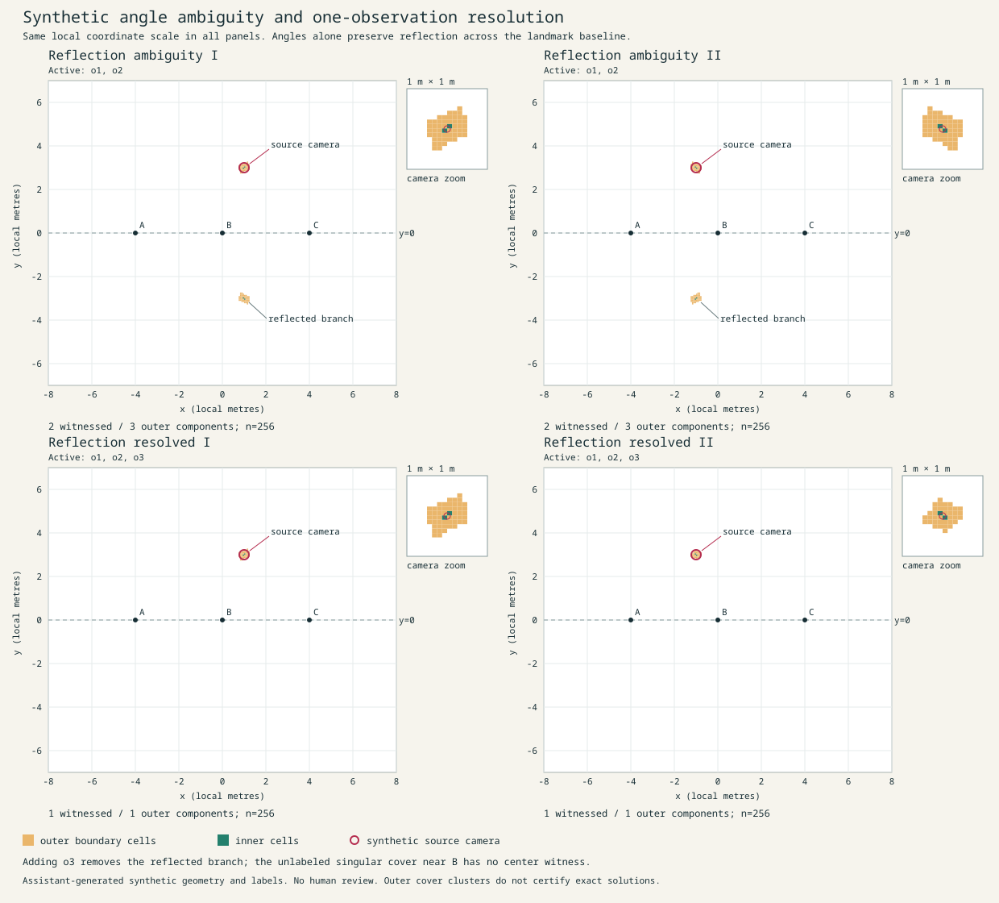

# Project 24: Field of possibility

A local, synthetic geolocation teaching laboratory. Toggle landmark observations, inspect the surviving camera regions, and reveal the separately stored camera position. The solver retains competing regions and distinguishes incompatible evidence from a region that remains unresolved at the chosen resolution.

## Run

No installation or third-party package is required. Verified on Arch Linux with Python 3.14.8. These commands work in Bash and Fish:

```sh
git clone https://github.com/NoahWLono/Coalition-of-the-BASED-AI-Defense-Research.git
cd Coalition-of-the-BASED-AI-Defense-Research/project24-geolocation-lab
python3 -m geolab.server --port 8764
```

Open [the local laboratory](http://127.0.0.1:8764). Stop the server with Ctrl+C. If that port is already occupied, select another with `--port 8765`. The service binds only to 127.0.0.1, runs one request at a time, and serves read-only data. It is a local teaching service. The eight-entry result cache reports the original computation time when serving a cached result.

Start with **Reflection ambiguity I**. Two unsigned landmark angles preserve solutions above and below the landmark line. Click **Add the distinguishing observation** to add a calibrated bearing. Reveal the synthetic camera and compare grid resolutions. **Reflection ambiguity II** and the two resolved presets provide the other teaching examples. A third, unwitnessed cover cluster near a landmark is a numerical ambiguity to inspect, not an established third answer.



The interface opens in dark mode. Use the **Theme** control to choose Dark, Light, or System; the browser remembers the choice when local storage is available. System follows changes to the operating-system preference. The survey map, labels, controls, and status colours share the selected palette.

## Reproduce the evidence

```sh
python3 -m geolab.generate
python3 -m unittest discover -s tests -v
python3 -m geolab.evaluate
node --check web/app.js
```

Node is used only for the optional JavaScript syntax check. Generation uses seed 240017. Evaluation is single-process and took about 15 seconds on this host. It records per-scene timings, areas, coverage, and failure classifications. Restart a running server after regenerating inputs because it loads them at startup. `bash reproduce.sh` runs the complete workflow, including optional PNG rendering when rsvg-convert is installed.

The dataset contains 20 benchmark scenes, 3 analytic fixtures, 4 tuning scenes, 12 held-out bounded-noise scenes, and 12 held-out Gaussian scenes. The held-out cases use different sampled camera configurations and noise draws; most share the benchmark landmark layout. They are a small synthetic generalization check, not a real-world validation dataset. No parameters were adjusted to improve held-out coverage.

## Artifacts

| Artifact | Purpose |
| --- | --- |
| [Geometry specification](docs/geometry.md) | Coordinates, schema, observation models, inclusion argument and numerical limits |
| [Coverage report](reports/coverage.md) | Measured inclusion, uncertainty in area, timing and failure interpretation |
| [Machine-readable results](reports/evaluation.json) | Every scene and all check counts |
| [Teaching comparison](reports/teaching.svg) | Two ambiguous cases and two resolved cases |
| [Rendered teaching comparison](reports/teaching.png) | Visually checked PNG of the same geometry |
| [Generator](geolab/generate.py) | Seeded synthetic geometry and independent answer keys |
| [Region solver](geolab/solver.py) | Coarse enumeration, adaptive pruning, inner cells and outer cover |
| [Reference checker](geolab/reference.py) | Independently implemented brute-force point-grid checker |
| [Implementation review](docs/geometry-review.md) | Mathematical argument and adversarial tests |
| [Execution record](reports/execution.md) | Environment, commands, sources, review and browser checks |
| [Original mission](docs/mission.txt) | Authorized scope and success criteria |

The delivered source, data, documentation and evidence have a SHA-256 manifest. Check the saved artifact set from the project directory with `sha256sum -c reports/SHA256SUMS`. Regenerating timed reports changes their hashes.

## What the results establish

The recorded audit uses a 128 × 128 final solver lattice and a separate 256 × 256 point reference. All 428 accepted reference samples were retained. Every valid bounded held-out camera was covered (12/12). Adding observations passed 60 subset comparisons; seven scenes passed refinement comparisons at 64, 128 and 256. The reports retain zero-width analytic cases that a point grid misses.

For Gaussian one-sigma intervals, only 5/12 source cameras satisfy every observation constraint. The coarse outer cover happens to include 9/12. That larger count measures numerical over-inclusion; it is not a 75% calibrated confidence claim. No frequentist calibration, posterior probability, or real-world accuracy is asserted.

The default narrow scenes have no entirely feasible cells at resolution 128, so their area lower bounds are zero. At resolution 256 the four teaching scenes supply 60 checked inner-cell corners and centers with no failures. Additional broad-tolerance and rectangular-domain tests exercise nonzero inner regions.

The geometric enclosure argument is valid in real arithmetic. Python floating-point operations use an empirical angular pad without a formal rounding certificate. Outer clusters may contain extra cells or merge true branches. Cell diagonal measures grid resolution and does not bound distance to the nearest exact solution. These are material limitations of the delivered numerical prototype.

All data, landmarks, terrain, cameras and annotations are synthetic and assistant-produced. Camera coordinates live in `data/truth/`; the solver receives only `data/inputs/`. The browser fetches the answer key only on reveal. The lab does not use imagery or identify real locations. Computation runs locally, while the coding assistant uses model-service processing; this is not described as an offline AI workflow.
